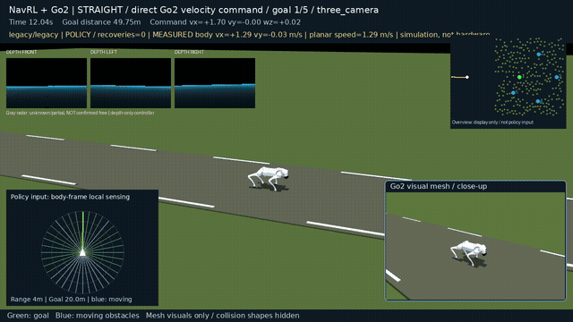
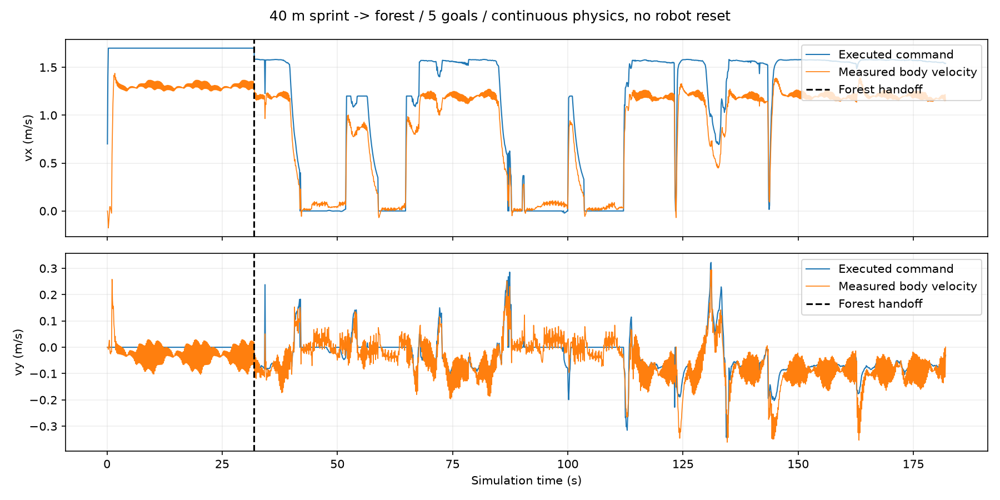

# Go2 Three-Camera Navigation

MuJoCo navigation experiments for a **Unitree Go2** with **front / left / right depth cameras**. Includes a trained high-level checkpoint, full visual meshes, a 40 m sprint approach, a dense forest, and continuous multi-goal navigation.

[中文快速开始](docs/QUICKSTART_ZH.md) · [Inputs and outputs](docs/INPUT_OUTPUT.md) · [Third-party sources](THIRD_PARTY.md)



Full video and measured speed results are provided in [Releases](https://github.com/xiaygyg/go2-three-camera-nav/releases).

## What runs

- Articulated Go2 dynamics: 12 joints, 200 Hz physics, frozen 50 Hz locomotion controller.
- Three rendered depth images: forward, left and right; rear and camera seams remain unknown.
- NavRL-inspired, locally trained 10 Hz navigation policy plus depth-only safety and persistent escape supervision.
- A **40 m straight approach** before entering a **66 × 46 m forest** with 260 trees, 30 rocks, and five sequential goals. The sprint scene adds four trees near the entrance/route.
- Continuous handoff and goal changes, with no robot or locomotion-controller resets.
- H.264 recording with depth images, local scan / visibility, target direction, commanded and measured body velocity, and a display-only scene overview.

This is an independent MuJoCo quadruped adaptation. It is not the original aerial NavRL task or the official Isaac Gym SEA-Nav benchmark. SEA-Nav supplies the frozen locomotion modules; the navigation policy here has its own observation and training interface.

## Recorded release demo

One predeclared seeded route, using the released checkpoint and default recovery:

| Measured result | Value |
|---|---:|
| Straight requested speed | 1.70 m/s |
| Straight mean forward speed after startup | 1.30 m/s |
| Straight peak planar speed | 1.44 m/s |
| Steady straight vx tracking RMSE | 0.40 m/s |
| Forest mean planar speed | 0.83 m/s |
| Goals reached | 5 / 5 |
| Collision / fall / robot reset | 0 / 0 / 0 |
| Simulation duration | 182 s |



This is one continuous demonstration, not a multi-seed success-rate claim. The GIF is a 15-second excerpt from separate moments of the uncut recording. The tracking bias is retained and reported rather than treating a 1.7 m/s request as achieved speed. Numeric results are in `media/demo_metrics.json`; the full video and telemetry CSV are release assets.

## Quick start (Linux)

Python 3.10+ and an OpenGL rendering backend are required. Linux with NVIDIA EGL is the tested headless configuration. The high-level policy can run on CPU; PyTorch CUDA is optional for training.

```bash
git clone https://github.com/xiaygyg/go2-three-camera-nav.git
cd go2-three-camera-nav
python3 -m venv .venv
source .venv/bin/activate
python -m pip install --upgrade pip
python -m pip install -e '.[test]'
python scripts/download_assets.py
pytest -q
```

Public meshes, locomotion models and the optional NavRL initialization checkpoint are fetched at pinned revisions and checked against SHA-256. They are not silently substituted if verification fails. Their upstream terms remain applicable.

### Record the sprint-to-forest demo

```bash
bash scripts/run.sh scripts/run_go2_patrol.py \
  --video --approach-length 40 --sprint-mode command --sprint-speed 1.7 \
  --seconds-per-goal 120 --name my_sprint_forest
```

The straight segment requests **1.7 m/s**, the supported upper bound of this navigation configuration. This is a tracking test, **not a claim about Go2 hardware maximum speed**. On crossing the forest entrance, the navigation policy and its depth-only supervisor take over. The three cameras remain active throughout. Inspect measured speed, tracking error, collisions and completed goals rather than the desired speed alone.

Add `--viewer` for an interactive MuJoCo window on a desktop. On a desktop system without EGL, set `MUJOCO_GL=glfw`. Output names must be new; recordings are never silently overwritten.

```bash
# No straight approach: continuous random-goal forest navigation.
bash scripts/run.sh scripts/run_go2_patrol.py \
  --approach-length 0 --random-goals 5 --seed 2026 \
  --video --seconds-per-goal 120 --name random_patrol
```

Targets are supplied as coordinates and projected into the robot frame. This demo does not perform semantic object detection. Procedural scene construction reserves traversable corridors; the policy does not receive these corridors or a global obstacle map.

### Train a new high-level policy

```bash
# Fresh output directory required. Lower locomotion models stay frozen.
bash scripts/run.sh scripts/train_go2_navigation.py \
  --sensor three_camera --scenario forest --envs 8 \
  --warmup 800 --steps 131072 --seed 2222 \
  --output runs/go2_camera_training

# Short installation check; not a useful trained policy.
bash scripts/run.sh scripts/train_go2_navigation.py \
  --envs 2 --warmup 1 --steps 128 --output runs/install_check
```

Training uses a local synthetic teacher warm-up followed by PPO in articulated physics, with a training-only behavior-cloning regularizer. Safety and explicit recovery are part of the training environment. Increasing `--steps` increases the budget; it does not guarantee success. Use `--checkpoint runs/go2_camera_training/final.pt` with the demo to test your own policy.

### Evaluate fixed tasks

```bash
bash scripts/run.sh scripts/evaluate_go2_navigation.py \
  --checkpoint assets/checkpoints/go2_three_camera.pt \
  --plan configs/evaluation_routes.json --seconds 90 --name fixed_eval
```

This evaluator scores the **first goal of each listed route**, retaining failures. It is not an evaluation of every later waypoint. Use the patrol demo for a complete continuous mission. Recovery is enabled by default; `--no-recovery` is an explicit ablation. Experimental lateral-first escape modes are opt-in and are not claimed to outperform the default.

## Files

| Path | Purpose |
|---|---|
| `go2_nav/` | Go2 dynamics, high-level policy, frozen lower-policy interface, recovery and recording |
| `go2_nav/common/` | Camera processing, scan safety, scenes, training teacher and shared numerical utilities |
| `configs/go2_three_d435i.json` | Explicit uncalibrated simulation camera rig |
| `assets/checkpoints/go2_three_camera.pt` | Portable navigation weights; no machine-specific metadata |
| `assets/sources.json` | Pinned download URLs, sizes and hashes |
| `scripts/` | Download, training, evaluation and demo entry points |
| `docs/INPUT_OUTPUT.md` | Tensor shapes, coordinates, units and control limits |
| `media/` | Short demonstration preview and public measured results |

The camera configuration is a simulation assumption, not a calibrated hardware installation. No hardware performance or deployment safety is established by this repository. Dynamics-based rewards, collision checks and procedural task sampling use simulator state; camera-mode navigation does not use geometric obstacle ground truth for sensing.

## License and attribution

Original adaptation code is MIT licensed. NavRL-derived components retain [NavRL's MIT notice](docs/NavRL-LICENSE.txt). MuJoCo Menagerie assets and SEA-Nav weights remain subject to their own upstream terms; see [THIRD_PARTY.md](THIRD_PARTY.md). The source repository does not bundle those third-party runtime downloads.
